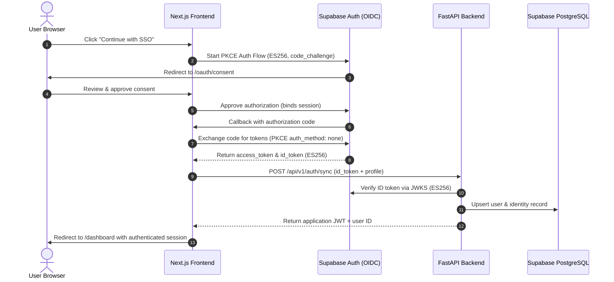

# Supabase + NextAuth + FastAPI Full-Stack Authentication Skill

This skill provides the complete architecture, implementation patterns, and debugging runbooks for a hardened, production-grade authentication system.

---

## The 5 Critical Implementation Rules

1. **Supabase Signs with `ES256`, NOT `RS256`**:
   - In NextAuth's `openid-client`, you **must** explicitly configure:
     `client: { token_endpoint_auth_method: "none", id_token_signed_response_alg: "ES256" }`
   - Omission causes `RPError: unexpected JWT alg received, expected RS256, got: ES256` (surfaced as `OAuthCallback` error).

2. **Public Client Token Endpoint Authentication**:
   - In OAuth 2.1 PKCE public client flows, do NOT send `client_secret` or HTTP Basic Auth headers.
   - Set `token_endpoint_auth_method: "none"`. Sending credentials causes Supabase to return `400 invalid authentication method`.

3. **Supabase OAuth Consent Binding**:
   - Supabase requires binding the active user session before approving an authorization ID.
   - The consent page must call `GET /auth/v1/oauth/authorizations/{id}` with the user's `Bearer access_token` before calling `approveAuthorization()`.

4. **Supabase Database Pooler Configuration**:
   - Projects may reside on **`aws-1`** (e.g. `aws-1-eu-central-1.pooler.supabase.com:6543`), not always `aws-0`. Verify the exact pooler host.
   - Passwords with special characters (such as `*` or `%`) must be URL-encoded (e.g., `*` &rarr; `%2A`).
   - For transaction poolers (port 6543) and serverless runtimes, set `statement_cache_size=0` and use `NullPool` to prevent prepared statement conflicts.

5. **Self-Healing Token Sync & Retry**:
   - In NextAuth's `jwt` callback, if `token.syncError` is present, do NOT skip the callback on reload. Allow re-attempting synchronization so transient backend network glitches can be resolved with a page reload.

---

## Directory Reference

| Document | Purpose |
| :--- | :--- |
| [Supabase OIDC & PKCE Setup](./references/supabase-oidc-pkce.md) | OIDC provider setup, ES256 tokens, and consent screen |
| [NextAuth Configuration](./references/nextauth-configuration.md) | Full NextAuth options, resilient callbacks, and retry |
| [FastAPI Backend Auth Sync](./references/fastapi-auth-sync.md) | Endpoint implementation, JWKS verification, and user upsert |
| [Supabase Pooler & Database Config](./references/supabase-postgres-pooler.md) | Connection strings, asyncpg, port 6543, and serverless |
| [Auth Email Templates](./references/email-templates.md) | Responsive, luxury email templates for confirm & reset |

---

## Quick-Start Checklist for New Projects

- [ ] **Supabase Dashboard**: Enable OIDC in Auth Settings, configure Redirect URLs.
- [ ] **Frontend Environment**: Set `OIDC_ISSUER_URL`, `OIDC_CLIENT_ID`, `NEXTAUTH_SECRET`, `NEXTAUTH_URL`.
- [ ] **NextAuth Route**: Implement [`[...nextauth]/route.ts`](./examples/nextauth-route.ts) with `id_token_signed_response_alg: "ES256"`.
- [ ] **Consent Page**: Mount [`/oauth/consent/page.tsx`](./examples/consent-page.tsx) with session binding.
- [ ] **Backend Endpoint**: Implement [`/api/v1/auth/sync`](./examples/fastapi-sync-endpoint.py) with Supabase JWKS verification.
- [ ] **Database Connection**: Use [`database.py`](./examples/database-config.py) with `statement_cache_size=0` for port 6543.
